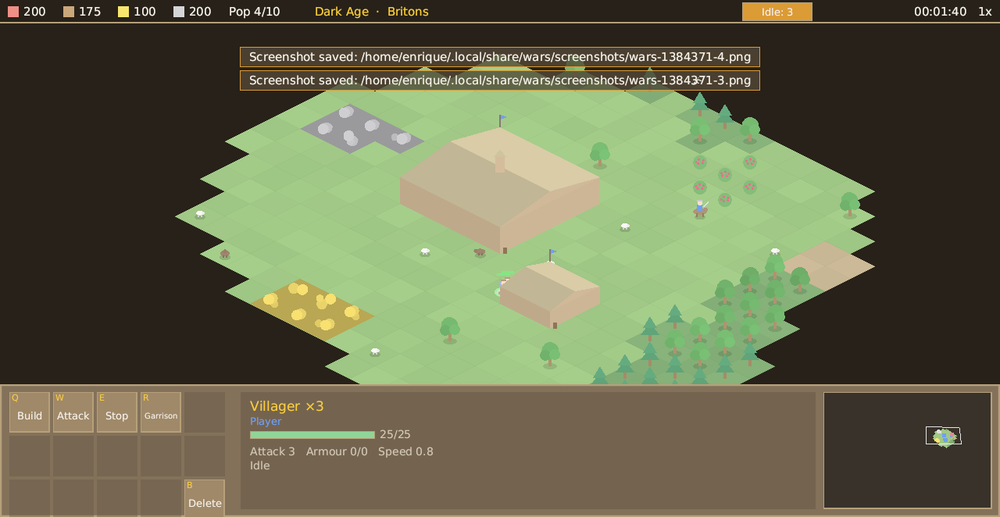

# Wars

**An open-source real-time strategy game in the spirit of the classic age-advancing RTS.**
Advance from the Dark Age to the Imperial Age, gather food, wood, gold and stone, raise a
town, research technologies and lead one of thirteen historical civilisations against
other players or the computer.

Built by Enrique Magallón. MIT. Hosted edition at `wars.3m4.net`; the server is free to self-host.



| Surface | Where | How to run |
|---|---|---|
| Server | `crates/server` (Rust, axum, Postgres) | `make up` → http://localhost:8086 |
| Desktop (Linux / Windows / macOS) | `crates/desktop` (winit + wgpu, in-house UI) | `cargo run --release -p wars-desktop` (`--quick`, `--screenshot out.png`) |
| Console | `crates/tui` (ratatui) | `cargo run --release -p wars-tui` |
| Android | `apps/android` (Kotlin shell over the Rust engine) | `make android` → `adb install -r apps/android/app/build/outputs/apk/debug/app-debug.apk` |
| iOS | `apps/ios` (SwiftUI shell over the Rust engine) | GitHub Actions `ios` workflow → `wars-ios.ipa` (sideload) |

One deterministic simulation (`crates/sim`) runs everywhere; clients play in lockstep
through the server or fully offline against the AI. Every picture on screen is drawn
procedurally from shapes; there are no bitmap assets.

## What is in the box

- 13 civilisations with bonuses, unique units and tech-tree gaps; 4 ages; ~60 unit and
  building types; ~90 technologies; monks and relics; siege; navy; walls; wonders.
- Random maps (Arabia, Black Forest, Islands, Arena, Highland, Coastal) in five sizes,
  deathmatch and regicide modes, cheats on request.
- A scenario editor (terrain, objects per player, players, trigger templates, test play).
- Computer players at three levels.
- Online lobbies with room codes, host controls, chat, saves, replays and a ladder,
  signed in with your 3m4 account or as a guest.
- The classic HUD with grid hotkeys (`Q W E R T / A S D F G / Z X C V B`), `H` town
  centre, `.` idle villager, control groups, box select, double-click select type.

## Repository map

```
crates/sim      deterministic simulation (fixed point, lockstep, snapshots, triggers)
crates/data     civilisations, units, buildings, technologies
crates/mapgen   random maps and the scenario format
crates/ai       the computer player
crates/proto    client/server messages
crates/client   offline match runner, lockstep follower, selection, saves, networking
crates/render   wgpu renderer, text, isometric camera, procedural art
crates/ui       immediate-mode widgets
crates/app      every screen and the in-game HUD (shared by desktop and mobile)
crates/desktop  winit shell            crates/tui  console client
crates/server   axum server            crates/ffi  C ABI + JNI bridge for mobile
apps/android    Kotlin shell           apps/ios    SwiftUI shell + XcodeGen spec
docs/           DESIGN.md, CONTRACT.md, MORNING.md, research/
```

## Developing

```bash
./scripts/check.sh      # fmt + clippy -D warnings + tests (CI runs the same)
make db && make server  # Postgres in docker, server from source
cargo run -p wars-mapgen --example ascii -- arabia 7   # print a map
cargo run -p wars-ai --example botmatch                 # headless AI vs AI
cargo run -p wars-client --features net --example smoke  # 2 guests + AI vs the live server
```

Rules for contributors are in `CLAUDE.md`; the game rules in `docs/DESIGN.md`; the
protocol in `docs/CONTRACT.md`.
